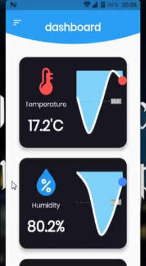
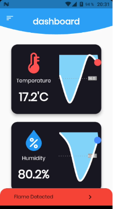
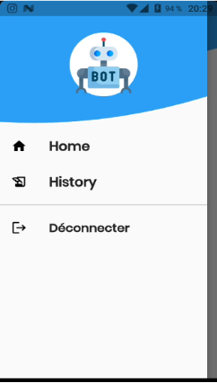

# SHAM — IoT Fire Detection Robot (Java)

##  Project Overview

**SHAM** is an IoT-based fire detection project designed to monitor environmental conditions inside a house and alert users when a potential fire is detected.

This repository contains the **Java mobile application**, which serves as the user interface for a larger IoT system involving sensors, a microcontroller, and a Raspberry Pi. The application receives and displays environmental data collected by the robot, allowing users to monitor temperature, humidity, and fire detection status.

The project was developed as an academic project to explore IoT integration and Android application development using Java.

##  Related Repository

This project was implemented using two different mobile development technologies. The repositories contain separate implementations of the mobile application.

- **Flutter version:** [sham-fire-robot-flutter](https://github.com/HibaBenNasr/sham-fire-robot-flutter)

##  Project Objectives

- Monitor indoor environmental conditions using IoT sensors.
- Display temperature and humidity readings in the mobile application.
- Detect potential fire situations using a flame sensor.
- Notify users of dangerous conditions through the application.
- Provide access to historical environmental data.
- Connect the mobile application to a cloud database.

##  Features

- **User Authentication:** Login interface for accessing the application.
- **Real-Time Monitoring:** Dashboard displaying temperature and humidity readings received from the IoT system.
- **Fire Detection Status:** Dashboard updates to reflect a detected fire condition.
- **Environmental Data History:** Access to previously collected monitoring data.
- **Cloud Integration:** Firebase Cloud Firestore is used to store and retrieve application data.
- **Navigation Menu:** Access to the application's main sections.

##  Technologies Used

- **Java** — Programming language used to develop the mobile application.
- **Android SDK** — Android application development framework.
- **Android Studio** — Development environment.
- **Firebase Cloud Firestore** — Cloud database integration.
- **IoT Hardware** — Sensors and embedded devices responsible for collecting environmental data.

##  IoT System and Hardware

The mobile application is part of a larger IoT system composed of the following hardware components:

- **Arduino Mega** — Microcontroller used in the robot.
- **Raspberry Pi** — Processing unit connected to the Arduino through serial communication.
- **Flame Sensor** — Detects the presence of flames.
- **DHT22 Sensor** — Measures temperature and humidity.
- **Gas Sensor** — Monitors gas levels.
- **Raspberry Pi Camera** — Captures images in the event of a fire.
- **L293D Motor Shield** — Motor control component.
- **Two Stepper Motors** — Provide movement for the robot.

When a potentially dangerous situation is detected, the system can capture images and send them to the user through the mobile application.

##  Application Screenshots

### 1. Login Interface

The login screen provides access to the mobile application.

### 2. Real-Time Monitoring Dashboard

The dashboard displays the temperature and humidity readings received from the IoT system, allowing users to monitor environmental conditions.

### 3. Dashboard During Fire Detection

This screenshot illustrates how the dashboard changes when a fire is detected, reflecting the detected fire condition compared with the normal monitoring dashboard.

### 4. Navigation Menu

The navigation menu provides access to the application's main sections.

##  Project Demonstration

Watch the project demonstration video:

[**View the SHAM project demo**](https://github.com/user-attachments/assets/97a52a32-124e-43b0-ad0d-28a012906482)

##  Project Context

This project was developed as an academic project focused on IoT-based environmental monitoring, fire detection, cloud integration, and Android application development.

The Java implementation demonstrates how an Android application can be integrated into a connected embedded system to make environmental data accessible to users.
